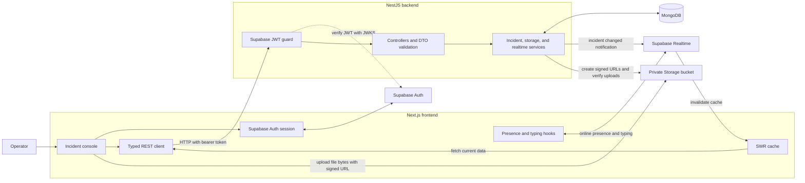

# Real-Time Incident Command Center

A full-stack incident management demo. The Next.js frontend talks to a NestJS API for incident data. MongoDB is the source of truth for incidents and attachment metadata; Supabase provides Auth, private file storage, and Realtime messaging.

## System design



### Data ownership

| Data | System |
| --- | --- |
| Operator accounts and authentication | Supabase Auth |
| Incident records and attachment metadata | MongoDB |
| Uploaded file bytes | Supabase Storage, private `incident-evidence` bucket |
| Presence, typing, and incident-change notifications | Supabase Realtime, ephemeral |

### Main flows

- **Incident changes:** the browser sends a bearer-authenticated request to NestJS. The backend verifies the Supabase token, writes to MongoDB, and publishes a small Realtime notification. Other browsers receive it and refetch authoritative data from the API.
- **File uploads:** the backend creates a signed upload URL. The browser uploads bytes directly to Supabase Storage, then asks the backend to verify the object and save its metadata in MongoDB.
- **Collaboration:** browsers use private Realtime channels for workspace and incident presence and typing. The backend publishes trusted incident-change notifications after successful writes.

All authenticated users currently share access to incidents. The assignee picker uses currently online operators; there is no separate roles system or persistent team directory.

For the detailed design, upload sequence, channel list, and implementation file map, see [`docs/system-design/README.md`](docs/system-design/README.md).

## Run locally

Requirements: Node.js 22+, pnpm, npm, a MongoDB database, and a Supabase project.

1. Copy `backend/.env.example` to `backend/.env` and fill in server-side values.
2. Copy `frontend/.env.example` to `frontend/.env.local` and fill in browser-safe values.
3. In Supabase, configure the Auth redirect URL, create a private `incident-evidence` Storage bucket, and apply the Realtime policies in [`docs/supabase-realtime-policies.sql`](docs/supabase-realtime-policies.sql).
4. Start the backend:

   ```bash
   cd backend
   npm install
   npm run start:dev
   ```

5. In another terminal, start the frontend:

   ```bash
   cd frontend
   pnpm install
   pnpm dev
   ```

The frontend runs at `http://localhost:3000`; the API defaults to `http://localhost:3001`. Swagger UI is at `http://localhost:3001/docs` and the OpenAPI JSON is at `http://localhost:3001/docs-json`.

Do not commit populated `.env` files, Supabase secret keys, MongoDB credentials, or access tokens.
