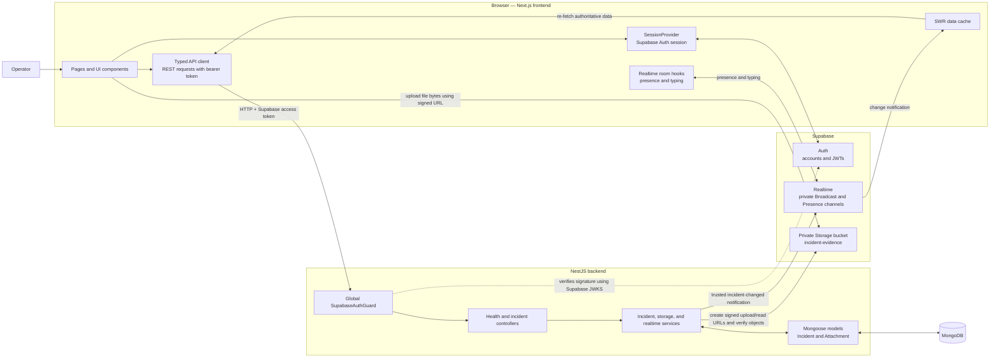
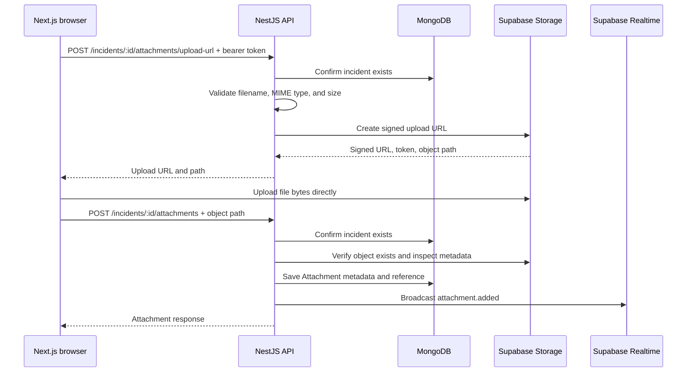

# Incident Command Center — System Design

This document describes the system that is currently implemented in this repository.

## Architecture

The browser talks directly to Supabase Auth, Realtime, and Storage for their respective jobs. Incident reads and writes go through NestJS. MongoDB is the source of truth for incident records and attachment metadata; Realtime notifications tell clients when to refresh that data.

## Sign-in and API request flow

1. The frontend signs the operator in with Supabase Auth.
2. Supabase returns a user session and access token. The frontend derives the displayed operator name and ID from the Supabase user.
3. The typed API client sends incident requests to NestJS with `Authorization: Bearer <access-token>`.
4. NestJS runs `SupabaseAuthGuard` globally. `TokenVerifierService` verifies the JWT signature using the project's JWKS (or the legacy HS256 secret when configured) and attaches the authenticated user ID to the request.
5. Controllers call services; Mongoose reads or writes MongoDB; NestJS returns JSON.

`GET /health` is public. Incident endpoints require a valid Supabase access token. The backend does not implement sign-in or issue tokens.

## Data ownership

| Data | Stored in | Notes |
| --- | --- | --- |
| Operator accounts and credentials | Supabase Auth | User IDs are used as `createdByUserId`, `assignedUserId`, and `uploaderUserId` references. |
| Incident records | MongoDB | Title, description, severity, status, assignee and creator IDs, resolution time, and timestamps. |
| Attachment records | MongoDB | Incident reference, uploader ID, filename, MIME type, size, bucket, and object path. |
| Uploaded file bytes | Supabase Storage | Kept in the private `incident-evidence` bucket. |
| Live presence, typing, and notifications | Supabase Realtime | Ephemeral messages; not the durable source of incident data. |

The app does not create incident tables in Supabase's `public` schema. The private Realtime policies apply to `realtime.messages` and channel topics instead.

## Evidence upload flow

Files must be PNG, JPEG, WebP, GIF, or PDF and smaller than 10 MiB. The backend signs uploads and downloads with its server-only Supabase key. Download URLs expire after five minutes.

## Realtime flows

| Channel | Publisher | Subscribers | Purpose |
| --- | --- | --- | --- |
| `workspace:incident-changes` | NestJS, after a successful MongoDB change | Authenticated browser clients | Sends only the incident ID, event type, and timestamp. The frontend invalidates SWR caches and re-fetches data from the API. |
| `workspace:ops` | Browsers | Browsers | Shares online operator presence and workspace collaboration signals. The console shell owns one subscription and shares its member list with incident forms. |
| `incident:<id>` | Browsers | Browsers | Shares presence and typing for people viewing or editing one incident. |

The Realtime policies are in [`../supabase-realtime-policies.sql`](../supabase-realtime-policies.sql). They control private channel access; they do not replace the backend's JWT guard for REST endpoints.

For an incident create, update, status transition, or attachment registration, the backend first persists the change, then broadcasts a minimal notification. The notification does not contain the incident body. Other clients use it as a signal to retrieve the latest data from NestJS.

## Preview mode

When `NEXT_PUBLIC_ENABLE_PREVIEW=true` and live API/Supabase configuration is incomplete, the frontend uses `preview-api.ts` and browser `BroadcastChannel` for a local demo. Preview data is temporary and is not written to MongoDB or Supabase Storage.

## API surface

The backend exposes 11 routes: public `GET /health` and 10 incident routes covering analytics, list/create/read/update/status, and attachment upload/registration/list/read-URL flows. Swagger UI is at `/docs`; its OpenAPI JSON is at `/docs-json`.

All authenticated operators currently share access to all incidents and can assign incidents to user IDs. The app has no separate role system or persistent team directory. The assignee picker currently offers operators who are online in Realtime, plus the current user and an already-saved assignee.

## Main implementation files

- Frontend session and API selection: [`session-provider.tsx`](../../apps/frontend/components/providers/session-provider.tsx), [`api-provider.tsx`](../../apps/frontend/components/providers/api-provider.tsx)
- Frontend REST client: [`http-api.ts`](../../apps/frontend/lib/api/http-api.ts)
- Frontend Realtime: [`use-realtime-room.ts`](../../apps/frontend/hooks/use-realtime-room.ts), [`use-incident-changes.ts`](../../apps/frontend/hooks/use-incident-changes.ts)
- Backend auth: [`supabase-auth.guard.ts`](../../apps/backend/src/auth/guards/supabase-auth.guard.ts), [`token-verifier.service.ts`](../../apps/backend/src/auth/services/token-verifier.service.ts)
- Backend incident behavior: [`incidents.controller.ts`](../../apps/backend/src/incidents/incidents.controller.ts), [`incidents.service.ts`](../../apps/backend/src/incidents/incidents.service.ts)
- Backend Storage and Realtime: [`storage.service.ts`](../../apps/backend/src/storage/storage.service.ts), [`realtime.service.ts`](../../apps/backend/src/realtime/realtime.service.ts)
